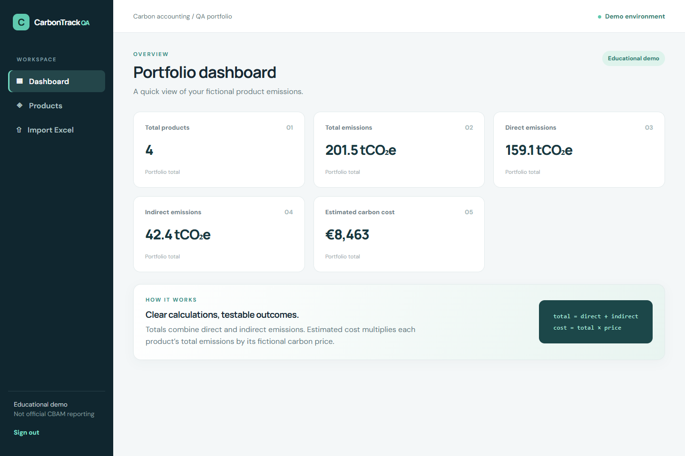
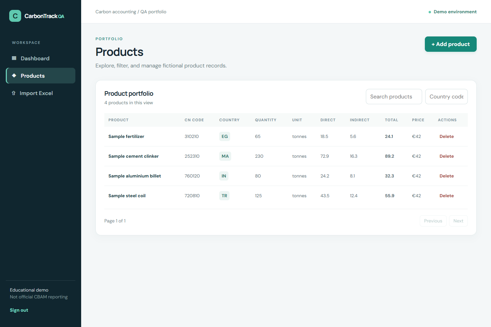
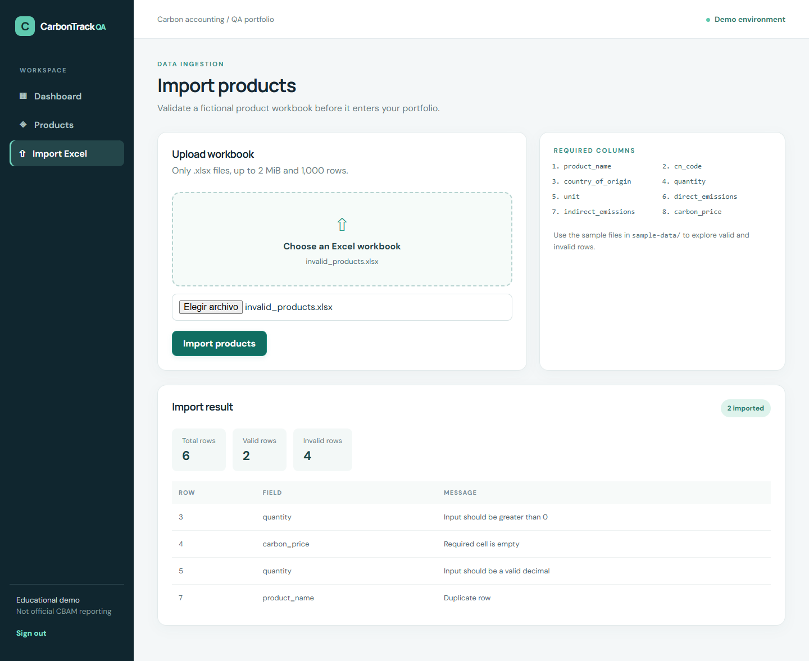

# CarbonTrack QA

**CBAM-Inspired QA Automation Platform** · Independent software engineering and QA portfolio project

CarbonTrack QA is a compact, fictional carbon accounting application built to demonstrate automated testing across a Python API, an Excel ingestion pipeline, a React interface, and CI. It is designed as a code sample for a Software Engineer & QA Automation internship application.

> **Independence and methodology:** This is an independent educational QA automation portfolio project inspired by the general challenges of carbon accounting and CBAM-related software. It is not affiliated with GeoKapti B.V. and does not reproduce any proprietary implementation. **This project uses simplified educational calculations and does not implement the official CBAM methodology.** All products, prices, and emissions values are fictional.

## What reviewers can inspect first

| Area | Evidence |
| --- | --- |
| Business logic | [`backend/app/services/emissions.py`](backend/app/services/emissions.py), parameterized unit tests |
| Data ingestion | [`backend/app/services/excel_import.py`](backend/app/services/excel_import.py), valid and invalid real `.xlsx` samples |
| API and isolation | [`backend/tests/api/`](backend/tests/api/), per-test SQLite fixtures |
| UI behavior | [`frontend/tests/`](frontend/tests/), Vitest and React Testing Library |
| Automation | [CI workflow](.github/workflows/ci.yml), lint, typecheck, coverage gate |

**Latest local verification (14 October 2026):** 67 backend tests passed with 97.14% coverage; 19 frontend tests passed with 97.26% statement coverage. Backend lint/format, frontend lint/typecheck/build, clean `npm ci`, and npm audit passed. Docker Compose configuration was parsed, but containers could not be run because Docker is not installed on this machine. See the [QA review](docs/QA_REVIEW.md).

## Features and stack

- **Backend:** Python 3.11+, FastAPI, Pydantic, SQLAlchemy, Alembic, PostgreSQL, JWT, Argon2, openpyxl.
- **Frontend:** React 18, TypeScript, Vite, responsive CSS, semantic forms and tables.
- **Testing:** pytest, pytest-cov, FastAPI TestClient, isolated SQLite, Vitest, React Testing Library, user-event, HTTP mocks, optional Locust script.
- **Workflows:** registration/login, owner and admin authorization, product CRUD, pagination/filtering/sorting, summary dashboard, partial Excel import with row-level errors.
- **Calculation:** `total = direct + indirect`, `intensity = total / quantity`, `estimated cost = total × carbon price`. These are deliberately simplified.

The default carbon price is a fictional local provider value of 42.00 when an API product omits `carbon_price`. A fake replaces that provider in a test. Excel always requires an explicit price.

## Architecture

```text
React pages → typed API client → FastAPI routes → services / repositories → SQLAlchemy → PostgreSQL
                                           ↘ Excel parser (openpyxl)
pytest → isolated SQLite per test          Vitest → mocked HTTP responses
```

Routes are thin. Pydantic validates requests, services handle calculations and file parsing, and the repository performs scoped queries. Each test creates a separate in-memory SQLite schema and overrides the API's database dependency. See [architecture](docs/ARCHITECTURE.md) and [project walkthrough](docs/PROJECT_WALKTHROUGH.md).

## Repository map

```text
backend/        FastAPI application, Alembic migration, pytest suite
frontend/       React application and interaction tests
sample-data/    Genuine generated Excel workbooks and generator
docs/           Architecture, QA plan, cases, interview and application notes
.github/        GitHub Actions CI
docker-compose.yml  PostgreSQL + API + Vite UI
```

## Getting started

### Prerequisites

Python 3.11+, Node.js 22+, npm, and PostgreSQL 16 for a local database. Docker Compose is an alternative to local PostgreSQL and manual startup. Ports 5432, 8000, and 5173 should be free. GNU Make is optional.

### Docker Compose

From the repository root:

```sh
docker compose up --build
```

This starts PostgreSQL, applies the Alembic migration, then starts the API and UI. The Compose credentials and fallback secret are **local demo settings**. Set `SECRET_KEY` in a root `.env` before using another environment (see `.env.example`). To stop: `docker compose down`.

### Run locally without Docker

Start PostgreSQL and create database/user matching `backend/.env.example`, or change `DATABASE_URL` to your own database. In `backend`, copy `.env.example` to `.env` and replace `SECRET_KEY` with a long random value.

**macOS/Linux:**

```sh
cd backend
python -m venv .venv
. .venv/bin/activate
python -m pip install -r requirements-dev.txt
alembic upgrade head
python -m app.db.seed                     # optional fictional demo data
uvicorn app.main:app --reload --port 8000
```

**Windows PowerShell:**

```powershell
cd backend
Copy-Item .env.example .env
python -m venv .venv
.\.venv\Scripts\python.exe -m pip install -r requirements-dev.txt
.\.venv\Scripts\alembic.exe upgrade head
.\.venv\Scripts\python.exe -m app.db.seed  # optional
.\.venv\Scripts\uvicorn.exe app.main:app --reload --port 8000
```

In another terminal, from `frontend`:

```sh
npm ci
npm run dev
```

On PowerShell with script execution disabled, use `npm.cmd ci` and `npm.cmd run dev`.

The optional seed creates `demo@example.test` with `DemoPass123` and four fictional products. Otherwise, register through `POST /api/v1/auth/register` before signing in. The UI deliberately does not create accounts; Swagger can register them.

| Service | URL |
| --- | --- |
| Frontend | http://localhost:5173 |
| API | http://localhost:8000 |
| Swagger | http://localhost:8000/docs |
| Health | http://localhost:8000/health |

Set `VITE_API_URL` for a different backend origin. Set `DATABASE_URL`, `SECRET_KEY`, `ACCESS_TOKEN_EXPIRE_MINUTES`, and `CORS_ORIGINS` in `backend/.env`; the latter is a JSON array of allowed browser origins. The local defaults allow both `localhost:5173` and `127.0.0.1:5173`.

## Tests and quality checks

From `backend` with the virtual environment active, or prefix tools with `.venv/Scripts/` on Windows:

```sh
ruff check app tests migrations ../sample-data/generate_samples.py
ruff format --check app tests migrations ../sample-data/generate_samples.py
pytest
pytest --cov=app --cov-report=term-missing --cov-report=html --cov-fail-under=85
```

From `frontend`:

```sh
npm run lint
npm run typecheck
npm test
npm run coverage
npm run build
```

The CI workflow runs both jobs on push and pull request, with the backend coverage threshold of 85%. See [test strategy](docs/TEST_STRATEGY.md), [test plan](docs/TEST_PLAN.md), and [manual cases](docs/TEST_CASES.md). The suite follows a testing pyramid: many focused unit cases, fewer API and migration cases, and interaction tests for the highest-value UI paths. Regular tests do not call external services.

If Make is installed, `make install`, `make backend-test`, `make frontend-test`, `make test`, `make lint`, `make coverage`, `make up`, and `make down` wrap the equivalent commands above. `make clean` removes generated build/coverage output.

## Excel import

Upload `.xlsx` through the UI or `POST /api/v1/imports/products` using a bearer token. The workbook must contain these columns in this order: `product_name`, `cn_code`, `country_of_origin`, `quantity`, `unit`, `direct_emissions`, `indirect_emissions`, `carbon_price`. It accepts at most 2 MiB and 1,000 data rows. Valid rows are imported; invalid rows return row/field messages. A repeated product identity is rejected per owner. The parser does not evaluate formulas or macros. See [Excel testing](docs/EXCEL_TESTING.md).

The genuine files [`valid_products.xlsx`](sample-data/valid_products.xlsx) and [`invalid_products.xlsx`](sample-data/invalid_products.xlsx) can be regenerated with `python sample-data/generate_samples.py` from the repository root after installing backend dependencies.

## API, performance, and screenshots

Swagger at `/docs` lists typed request and response models. [API testing notes](docs/API_TESTING.md) cover expected codes and database effects. For an optional small load exercise, install `backend/requirements-performance.txt`, set `LOAD_TEST_EMAIL` and `LOAD_TEST_PASSWORD` to a local account, and run `locust -f tests/performance/locustfile.py --host=http://localhost:8000` from `backend`. Keep it local and small; this is an example scenario, not a benchmark result.

These are real captures of the running UI with fictional local seed data:

| Dashboard | Products | Import result |
| --- | --- | --- |
|  |  |  |

To recapture them, run the API and frontend, seed the demo account, then run `npm run screenshots` from `frontend` with Microsoft Edge installed. The script opens the local application in headless Edge and uploads the invalid sample workbook for the import view. It uses only the documented fictional demo account.

## Known limits and future work

- The formulas are educational and have no regulatory validity. No official emission factors, tariff logic, or reporting workflow is included.
- SQLite tests are fast and isolated; SQLite's numeric and SQL behavior differs from PostgreSQL. The migration is tested on temporary SQLite, while the Compose stack is intended for PostgreSQL checks.
- The frontend stores a demo JWT in local storage. A production system would use a stronger session strategy and tighter account controls.
- The simple product identity rule is `(owner, name, CN code, country)`. Real ingestion would need a domain-specific deduplication policy and more detailed upload limits.
- Future work could add PostgreSQL CI integration, browser end-to-end tests, and accessibility automation.

## Troubleshooting

| Symptom | Check |
| --- | --- |
| Python install fails | Confirm Python 3.11+ and use a fresh virtual environment; invoke its own `python -m pip`. |
| Database connection refused | Start PostgreSQL, check `DATABASE_URL`, and confirm port 5432. |
| Migration fails | Verify database permissions and run `alembic upgrade head` from `backend`. |
| Docker fails | Confirm Docker Desktop/daemon is running and ports 5432/8000/5173 are free. |
| `npm` blocked in PowerShell | Use `npm.cmd` without changing system execution policy. |
| Frontend network error | Start backend and check `VITE_API_URL` and `CORS_ORIGINS`. |
| Port occupied | Stop the other process or change exposed ports and matching frontend API URL. |

## What I learned

This project demonstrates how to isolate database tests, cover boundary values with `Decimal`, keep Excel validation separate from HTTP handling, and test UI behavior through accessible controls. The main learning path is in [project walkthrough](docs/PROJECT_WALKTHROUGH.md) and [interview guide](docs/INTERVIEW_GUIDE.md).

## License

MIT; see [LICENSE](LICENSE).
