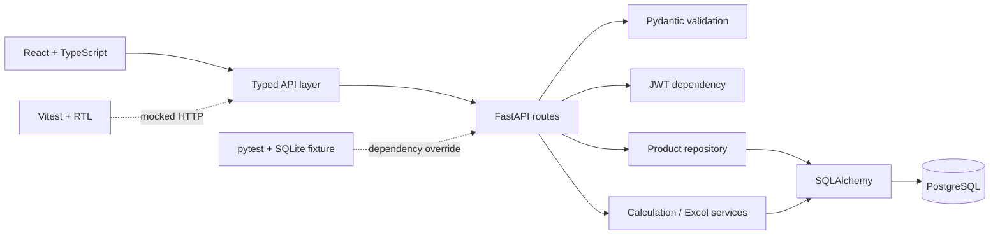

# Architecture

## Request and data flow

`backend/app/main.py` assembles routes, CORS, OpenAPI metadata, and consistent application/validation error handlers. Routes use `Db` and `CurrentUser` dependencies. The product repository applies owner-scoped filters, count queries, stable sorting, and pagination. Calculation and workbook parsing live in services so they can be unit tested without HTTP or a database.

## Security and ownership

Registration hashes passwords with Argon2. Login verifies credentials and issues a short-lived HS256 JWT signed by `SECRET_KEY`. Authentication extracts and validates the user; authorization checks ownership on individual product operations, with an admin exception. List and dashboard endpoints remain scoped to the logged-in user's own portfolio, including for admins. An inactive user cannot log in or use an existing token.

CORS accepts configured origins. The UI keeps a demo JWT in local storage and validates it via `/auth/me` on load. That is a demonstration convenience, not a production session design. API validation errors use `{"error":{"code","message","issues"}}`; domain errors use the same outer envelope without `issues`. Unexpected server errors get a sanitized `INTERNAL_ERROR` envelope; details are logged server-side.

## Excel pipeline

1. Route checks the `.xlsx` extension and 2 MiB size.
2. Parser opens a read-only workbook with formulas treated as stored values, and rejects malformed headers.
3. Each row gets Pydantic validation, with row/field errors and in-file duplicate detection.
4. Route checks existing identities for the owner, inserts valid rows, and commits once.
5. Response reports total, valid, invalid, imported, and row errors.

The exact header order is part of this small sample's contract. A real ingestion platform might support mappings, versions, and more flexible unit conversion. The 1,000-row limit bounds work per request.

## Database and migrations

PostgreSQL is the development/Compose database. SQLAlchemy models represent users and products; Alembic revision `0001_initial` creates the schema. `Numeric(28,10)` stores quantities, emissions, and prices in PostgreSQL. The application calculates with Python `Decimal`. The optional seed creates only fictional data in the configured database.

Regular tests override `get_db` with a new in-memory SQLite engine per test. They never connect to the configured PostgreSQL URL. A migration test instead creates a temporary SQLite file. SQLite's decimal and SQL semantics differ from PostgreSQL; a future PostgreSQL CI job would catch dialect-specific issues. The Docker startup runs migrations before serving requests.

## Deployment and CI

Compose starts PostgreSQL, backend, and Vite frontend with health dependencies. The backend container runs as a non-root user. GitHub Actions independently runs Python lint/format/tests/coverage and frontend lint/typecheck/tests/build. CI does not require a live network service during tests.
